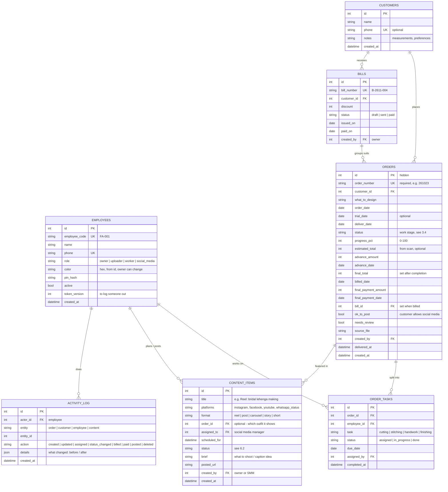

# Fab_art Studio — Roadmap

Planned features for the boutique management app, and the order we will build them in.
Every phase ends with something that works and can be deployed on its own.

**Status:** Phases 0–3 built, waiting to be deployed together · **Last updated:** 11 Nov 2026

---

## 1. What we want

| # | Feature | Short description |
|---|---------|-------------------|
| 1 | **Order number as the key** | Every order is identified by its order number (e.g. `261023`). It is unique and can't be missing. |
| 2 | **Customers saved properly** | Customers are stored as their own records (name, phone, notes), and every order is linked to one. |
| 3 | **Activity tracking** | Every change is recorded: who did what, and when, for orders, customers and employees. |
| 4 | **Three-step payments** | Advance → final bill once the piece is made → final payment. Each step has its own date. |
| 4b | **Combined bills** | One bill for all the suits a customer ordered, generated by the owner and sent on WhatsApp. |
| 4c | **Backups on your PC** | Download a full copy of the database to the Desktop, with one click. Nothing piles up on PythonAnywhere. |
| 5 | **Order calendar & progress** | A calendar shows deliveries and how far each order has got (cutting → stitching → ready …). |
| 6 | **Owner view** | For you and Mom. Shows everything, including the pending orders that still need to be assigned. |
| 7 | **Uploader view** | For the person who uploads orders. She uploads and checks scans and can see the boutique's earnings (see the [open questions](#11-open-questions)). |
| 8 | **Worker view** | Workers log in and see only the work assigned to them, and update their progress. |
| 9 | **Social media manager view** | She sees all orders and their progress, and tracks which ones have a reel. She has her own **content calendar**, where the owner posts her schedule. |
| 10 | **Employees with IDs** | The owner adds employees. Each one gets an ID (e.g. `FA-003`), a role and a colour. |
| 11 | **More colour** | Keep the current colour scheme, but make it less pale. Use each employee's colour across the app. |

---

## 2. Where we are today

- **One table:** `orders`. The customer name and phone are plain text on each order.
- **One shared password:** everyone who logs in is the same "admin".
- **Order numbers are not reliable yet.** The current 38 orders contain:
  - **Duplicates:** `261017` ×3, `261020` ×2, `261023` ×2, `261032` ×2. Some are re-uploads and some are scan misreads.
  - **Misread format:** `26/025`, `26/028`, `26/031`, `26/016`, `26019`. The scanner read the `1` as `/`, or dropped a digit.
  - **Missing:** one order has no number (`UNCLEAR`).
- **Customers can't be matched by phone yet.** Only 2 of 38 orders have a readable phone number.
- **Payments:**
  - `advance_payment` has been used as *"money received so far"*.
  - The handwritten "total" at order time is only an estimate, because the real total is decided after the piece is
    made. That's why advance equals total on 25 of 27 orders. This is **expected**, not a scanning bug.

So we have to **clean up the data before** order numbers can become the key. That is Phase 0.

---

## 3. Database design

### 3.1 How "order number as primary key" will work

Order numbers become the identifier you see and use everywhere: in links (`/orders/261023`), search and assignments.
They will be **required and unique**. The database refuses a second `261023`.

Inside the database we **keep the hidden numeric `id` as the technical primary key**. The order number gets a
`UNIQUE NOT NULL` rule on top. That gives you everything you asked for and avoids two problems:

- **Fixing a misread number is safe.** Tasks, reels and history point to the hidden `id`. Correcting `26/025` to
  `261025` therefore doesn't break those links.
- **The cleanup is easy to check.** Duplicates can be found and merged before the unique rule is switched on.

### 3.2 Payments — three steps, kept on the order (no extra table)

This is how the boutique already works. Each step is a field on the order, with its own date:

| Step | When | Fields | Example |
|---|---|---|---|
| 1. Advance | When the order is taken | `advance_amount`, `advance_date` | ₹3,000 on 2 Oct |
| 2. Final bill | After the piece is made | `final_total`, `billed_date` | ₹7,500 on 14 Oct (sent to the customer) |
| 3. Final payment | When the customer pays the rest | `final_payment_amount`, `final_payment_date` | ₹4,500 on 16 Oct |

Worked out automatically, never typed in:
- **Received** = advance + final payment.
- **Balance** = final total − received.
- **Payment state:** `advance only` → `bill sent` → `paid`.
- **Earnings by month** come from the dates on which money arrived (`advance_date`, `final_payment_date`).
  That is accurate without a separate payments table.
- **Estimate:** the handwritten "total" from the scan is saved as an optional `estimated_total`, as a hint.

**Moving the current data:**
- Today's `advance_payment` becomes `advance_amount`, dated with the order date.
- Today's `total_amount` becomes `estimated_total`.
- The owner sets `final_total` when billing.

### 3.2b Bills — one bill for several suits

A customer often orders more than one suit, so step 2 (the final bill) is done with a **bill** that can include
any number of that customer's orders. A bill with one suit is simply a bill with one line.

**Only the owner can generate bills.**

**How it works:**
1. **Pick the customer.** Open "New bill" from the customer's page or from the Pending tab. The app lists that
   customer's orders that aren't billed yet, with ready ones first.
2. **Tick the suits** to include, and enter each suit's **final price**. The estimate from the scan is filled in to
   start with.
3. **Check the totals.** The bill shows each suit's price, the advance already received, and the **amount due**
   (all final prices − all advances). An optional discount can be added.
4. **Generate & send.**
   - The bill gets a number, e.g. `B-2611-004` (year, month, running number).
   - It becomes a neat bill image / PDF, in Hindi or English, with the boutique name, each suit (order number and
     design) and the amount due.
   - It also carries a **UPI QR code / payment link** for the amount due.
   - Share it on WhatsApp in one tap.
   - Each included order gets its `final_total` and `billed_date`.
5. **Payment received.** One tap on the bill marks it paid. Each included order gets `final_payment_amount`, its
   share of the payment, and `final_payment_date`.
6. **Changes.** A bill can be edited (suits, prices, discount) until it's paid. Every change is written to the
   activity log.

**What this needs in the database:**
- A small `bills` table to group the suits: `bill_number`, `customer_id`, `discount`, `status` (draft / sent /
  paid), `issued_on`, `paid_on`, `created_by`.
- A `bill_id` column on orders.
- There is still **no payments table**. Amounts and dates stay on the orders, as in 3.2.

### 3.3 Tables

Notes:
- **Dates** are stored as real dates (`YYYY-MM-DD`), not text. Today they are mixed, e.g. `02/10/26` and `2026-10-02`.
- **Amounts** are stored as whole rupees (numbers), not text such as `"8,000"`.
- **Customer activity** is that customer's orders, payments and log entries, shown together as the chat-style
  timeline that already exists.
- **Reel status of an order** is worked out from its linked `content_items`:
  - "No reel yet" if it has none.
  - "Reel planned / editing / posted" otherwise.

### 3.4 Each suit's plan, and where the order is

Every suit is made differently, so there is **no fixed list of stages**. The owner gives each order its own
**plan**: steps in the order they happen, each with a speciality, a person (can be chosen later), a date and a
note. For example:

> 1. Collect materials (Sita) → 2. Cutting (Kamla) → 3. Machine work → 4. Handwork (Sita) → 5. Stitching (Kamla) →
> 6. Final check / delivery (Rani)

**Specialities** (`SPECIALITIES`), which are also the kinds of steps:

| Key | Hindi | English |
|---|---|---|
| `materials` | सामान लाना | Collect materials |
| `cutting` | कटिंग | Cutting |
| `machine` | मशीन का काम | Machine work |
| `handwork` | हाथ का काम | Handwork |
| `stitching` | सिलाई | Stitching |
| `final_check` | आखिरी जाँच / डिलीवरी | Final check / delivery |
| `social_media` | सोशल मीडिया | Social media (e.g. a reel of this suit) |
| `other` | दूसरा काम | Other work |

**Where the order is** (`status`):
- **Stages:** `received` (ऑर्डर मिला), `in_work` (काम चल रहा, shown with the current step, e.g. "कटिंग"),
  `ready` (तैयार), `delivered` (दे दिया), `cancelled` (रद्द).
- **Automatic changes:** the first step started puts the order in work. When every step is done it becomes
  ready, and reopening a step puts it back in work.
- **Progress:** the share of the steps that are done.

**One person, several specialities.** Each person keeps **one ID and one login (one phone number)** and can have
several specialities ticked. Their **role** (owner / uploader / worker / social media) still decides what they
can see. When the owner gives out a step, people with that speciality are shown first.

**Unfinished steps move to the next day.** Every day (Indian time), any step not done by its date moves to
today. The first date is kept, so the owner sees "moved forward 3 days", and each move is in the activity log.

## 4. Who sees what

There are four roles. The backend checks the role on **every request**, so hiding a button in the app is not the
only protection.

| Feature | Owner (you, Mom) | Uploader | Worker | Social media |
|---|:---:|:---:|:---:|:---:|
| Upload & scan PDFs, fix scan mistakes | ✅ | ✅ | — | — |
| Add / edit orders and customers | ✅ | ✅ | — | — |
| Delete orders | ✅ | — | — | — |
| See all orders and their progress | ✅ | ✅ | — | ✅ |
| **Pending / unassigned orders list** | ✅ | view only | — | — |
| **Assign work to workers** | ✅ | — | — | — |
| **My work** (own tasks only) | — | — | ✅ | — |
| Update own task status / progress | — | — | ✅ | — |
| Order calendar | all orders | all orders | own tasks | all orders (view) |
| **Content calendar** | ✅ post schedule | view | — | ✅ own schedule |
| Mark reels / posts done, add post links | ✅ | — | — | ✅ |
| **Generate bills** (single or combined) | ✅ | — | — | — |
| Record "payment received" | ✅ | ✅ *(Q1)* | — | — |
| **Download database backup** | ✅ | — | — | — |
| Prices, payments, **earnings** | ✅ | ✅ *(Q1)* | ❌ hidden | ❌ hidden *(Q7)* |
| Customer phone numbers | ✅ | ✅ | ❌ hidden *(Q3)* | ❌ hidden |
| Reports (monthly / yearly) | ✅ | ✅ *(Q1)* | — | content stats only |
| **Add / deactivate employees, reset PIN** | ✅ | — | — | — |
| Activity log | everything | own actions | own actions | own actions |

### Screens per role (phone, WhatsApp style)

- **Owner tabs:** Home · Orders · **Pending** · Calendar · More.
  - **Pending:** a list of unassigned, late and *ready-but-not-billed* orders. "Assign" opens a list of workers
    with their colour chip and how much work each already has.
  - **More:** Customers, Reports, **Content plan**, **Team**, Settings.
- **Uploader tabs:** Home · Upload · Orders · Calendar · More.
- **Worker tabs:** **My work** · Calendar · Profile.
  - **My work:** one card per task, showing the design text, the due date, and big **Start** / **Done** buttons.
  - No money is shown anywhere on worker screens.
- **Social media tabs:** **Plan** (her content calendar) · Orders · **Ready to shoot** · Profile.
  - **Ready to shoot:** orders that are finished, allowed to be posted, and don't have a reel yet.

### Login

- **Per person:** each employee logs in with **phone number + 4-digit PIN** instead of the shared password.
  This is easier on a phone than a long password.
- **What the login token holds:** the employee's `id`, `role` and `token_version`.
- **How long it lasts:** 30 days, kept on the phone, so nobody has to log in every hour like today.
- **Logging someone out:** "Log out everywhere" or deactivating an employee increases `token_version`.
  That cancels their old tokens straight away.

---

## 5. Order calendar & progress

- **Month view (desktop and phone):**
  - Each day shows its deliveries and trials as coloured dots, where the colour is the worker's colour.
  - A red outline marks late orders.
  - Tapping a day lists that day's orders, each with a progress bar.
- **Agenda view (phone default):** like a WhatsApp chat list, grouped by day.
  It shows "Today", "Tomorrow", "This week" and "Late".
- **Order card:**
  - Status chip, progress bar (`stitching · 50%`), assigned worker(s) and days left.
  - Payment state (`advance only` / `bill sent` / `paid`).
- **Workers:** the calendar shows only their own task due dates.

---

## 6. Social media manager

### 6.1 Her content calendar (works differently from the order calendar)

- **What it shows:** *content items* (reels, posts, stories), not orders. Each item is placed on the date and time
  it should be posted.
- **Owner posts the schedule:**
  - You create items on her calendar, e.g. *"Fri 6 pm · Instagram Reel · Bridal lehenga making (order 261023)"*.
  - Each item has a brief: what to shoot and a caption idea.
  - She sees them in her **Plan** tab.
- **She plans too:**
  - She can add her own items as **ideas**.
  - The owner can see them and move them onto the schedule.
- **Platforms:** Instagram, Facebook, YouTube Shorts and WhatsApp Status.
  - Each platform has its own icon and colour, kept separate from employee colours.
  - There is a filter by platform.
- **Views:**
  - **Week:** the default, because content is planned week by week.
  - **Month:** for the overview.
  - **List:** "This week's posts".
- **Linked orders:**
  - An item linked to an order shows that order's live work progress, e.g. *"Suit 70% done, shoot after Thursday"*.
  - She can then plan shoots around when outfits are ready.

### 6.2 Content stages

| Status | Hindi | Meaning |
|---|---|---|
| `idea` | आइडिया | Suggested, not scheduled yet |
| `planned` | तय | On the calendar with a date |
| `shooting` | शूटिंग | Being filmed / photographed |
| `editing` | एडिटिंग | Being edited |
| `ready_to_post` | पोस्ट के लिए तैयार | Done, waiting for the posting time |
| `posted` | पोस्ट हो गया | Live. She pastes the post link. |

### 6.3 Reel tracking on orders

- **Every order shows a reel badge:** `No reel` / `Reel planned` / `Posted ✓`, with a link to the post.
- **Customer consent:** a **"Customer OK to post"** switch on the order. Orders without it never show up in
  *Ready to shoot*.

---

## 7. Colours & employee IDs

- **Employee ID:** `FA-` plus a 3-digit number, given automatically (`FA-001`, `FA-002` …) and shown on the
  profile and in the Team list.
- **Employee colour:**
  - It is picked from a fixed set of 10 clear, easy-to-tell-apart colours, using `id % 10`.
  - It is saved in `employees.color`, so the owner can change it.
  - It is used for the employee's avatar, task chips, calendar dots and assignment badges.
- **Colour is never the only signal.** The employee's initials or name always appear next to their colour, so
  everything stays readable for colour-blind users.
- **Reserved colours:**
  - Status colours: green = ready or delivered, orange = needs review, red = late.
  - Platform colours on the content calendar.
  - Employee colours never use either set.
- **Less pale:**
  - Keep the green / beige look, but with stronger contrast.
  - Use filled accent buttons, coloured status chips and a coloured header on the owner's Home screen.
  - Darker secondary text.

---

## 8. Plan — phases

Each phase lists what we build and what is done at the end. **Back up `boutique.db` on PythonAnywhere before
every database change.**

### Phase 0 — Clean the data and set up safe migrations — ✅ built, not deployed yet
1. ✅ **Migrations:** Alembic is set up in `backend/migrations`, and the app no longer uses `create_all`.
   - `0001` is the baseline, the table as it is today.
   - `0002` cleans the data and switches the columns to proper types.
   - `0003` adds customers, three-step payments and bills (Phase 1).
   - `0004` adds employees and the activity log (Phase 2).
   - `0005` adds order stages, trial dates and work tasks (Phase 3).
   - `0006` makes order numbers unique and required. It is the **last** step on purpose: it waits until the
     duplicates have been fixed in the app, and the app needs `0005` to run.
   - The backend refuses to start until at least `0005` has run, with a clear message.
2. ✅ **Order numbers fixed automatically where it is safe:**
   - The `/` misread: `26/025` → `261025`.
   - Every change is written in the order's *clean-up note*.
3. ✅ **"Order number check" screen** (Settings, or the red banner on Home):
   - Same number on several orders: give each its own number, or delete the extra copy.
   - Orders without a number.
   - Numbers that look misread (not 6 digits, e.g. `26019`).
   - Dates to check: unreadable, an odd year like `18/10/22`, or delivery before the order date.
4. ✅ **Order numbers required and unique:**
   - The backend refuses duplicate or missing numbers on upload, add and edit.
   - The upload screen blocks saving and says which page has the problem.
   - The database rule is switched on by `0006`, once the check screen shows "All clear".
   - Links now use the order number (`/orders/261023`). Old links using the internal id still work.
5. ✅ **Proper types:**
   - Dates are real dates.
   - Amounts are whole rupees (`"8,000"` → `8000`).
   - `UNCLEAR` becomes empty, and the order is flagged for review.
   - Dates that couldn't be read are kept in the clean-up note, so nothing is lost.
6. ✅ **Backups to your PC:** see section 10.

**How to deploy Phases 0–3 (together):**
1. **Back up first:** run `Backup-Boutique-DB.bat` on your PC.
2. **Update the backend on PythonAnywhere** (in a Bash console):
   - `cd ~/Boutique_Management && git pull`
   - `cd backend && pip install -r requirements.txt` (use your virtualenv if you have one)
   - `alembic upgrade head`
   - It runs `0002` to `0005`, then stops at `0006` and lists the duplicates. **That's expected.**
3. **Reload the web app** on the Web tab, then deploy the new frontend.
4. **Owner login:**
   - Log in with **"Log in with the owner password"** (the same password as today). You are `FA-001`.
   - In **Settings → My profile**, enter your name, phone and a PIN.
   - Then add your mom, the uploader, the workers and the social media manager in **Settings → Team**.
5. **Fix the problems:** open **Settings → Order number check** and fix everything until it says "All clear".
6. **Finish:** run `alembic upgrade head` again, and reload the web app. Order numbers are now locked as unique.

✅ **Done when:** every order has a unique, correctly formatted number, and the check screen says
"Order numbers are unique and required ✓".

### Phase 1 — Customers + three-step payments — ✅ built, not deployed yet
1. ✅ **Customers table** (migration `0003`):
   - Existing orders are grouped by the same name, or the same phone number (last 10 digits).
   - Your data gives 23 customers. Sukhjinder and "Subh jinder" were joined by their phone number.
   - Names that only *might* be the same person show up on the Customers screen as **"Same person?"**, with
     **Merge** and **Not the same** buttons. For example: Manjot / Manjoot, Kavita Jain / Kavit Jain,
     Gagan Preet / Gagan Preet's.
2. ✅ **Customer screens:**
   - **Chat-style timeline:** orders are green bubbles and bills are white bubbles.
   - **Bottom bar:** "New order for …" and "Create bill".
   - **Customer info:** edit name, phone and **notes & measurements** (shown as a note at the top of the chat),
     merge with another customer, and delete (only if they have no orders).
3. ✅ **Choosing a customer on orders:**
   - Upload, add and edit all have a search-as-you-type customer box.
   - Scanned names are matched automatically to a saved customer: same phone, then same name.
   - Similar names are offered as a suggestion.
4. ✅ **Payment fields:**
   - `advance_payment` became `advance_amount` (+ `advance_date`, set to the order date).
   - `total_amount` became `estimated_total`.
   - Added `final_total`, `billed_date`, `final_payment_amount` and `final_payment_date`.
5. ✅ **Bills (section 3.2b):**
   - **New bill:** pick the customer, tick their unbilled suits, enter the final prices and an optional discount.
     The advances are taken off, and the bill gets a number like `B-2611-001`.
   - **Bill screen:**
     - The bill itself, with a **UPI QR code** for the amount due. Set your UPI ID in Settings → Boutique details.
     - **Share bill picture:** opens the phone's share sheet to WhatsApp, or downloads the picture.
     - **WhatsApp message:** a ready-made text with the suits and the amount.
     - **Print / PDF.**
     - Sharing the bill marks it "Sent".
   - **Payment received** (with the date) marks every suit paid. The discount is split across the suits by price.
     **Undo payment** reverses it.
   - **Editing:** a bill can be edited or deleted until it's paid. Deleting it puts the suits back to "not billed".
   - **Safety checks:** a suit can't be on two bills or on another customer's bill. A billed suit can't be deleted.
   - Bills are in the menu, on Home ("Balance to collect", "Not billed yet") and in Settings.
6. ✅ **Order page:** shows the three steps, **1. Advance → 2. Bill → 3. Paid**, with dates, a link to the bill, a
   "Create bill" link and the total received.
7. ✅ **Reports:**
   - **Home:** money received this month (by payment dates), balance to collect, and suits not billed yet.
   - **Monthly / yearly:** money received is now counted by the date it actually came in.
   - **CSV export:** includes every payment column.

**Not done yet:**
- **Scanned page next to the fields** (suggestion 1 in section 9) is still open.
  (Owner-only bills: ✅ done in Phase 2.)

✅ **Done when:**
- Customers are real records, and every order is linked to one.
- The owner can bill several suits on one bill.
- Earnings come from real money received.

### Phase 2 — Employees, roles, login, activity log — ✅ built, not deployed yet
1. ✅ **Employees** (migration `0004`):
   - **IDs and colours:** each person gets an ID (`FA-001`…) and a colour from a fixed set of 10. The set never
     uses the status colours, and the colour is always shown with the person's initials.
   - **First owner:** the old shared password login is **FA-001 (Owner)**. It still works as a fallback:
     "Log in with the owner password" logs in as the first active owner.
2. ✅ **Team page** (Settings → Team, owner only):
   - **Add a person:** name, phone, role (with a short description of what each role can see), first PIN and
     colour.
   - **Edit:** name, phone, role and colour; set a new PIN; deactivate or activate again.
   - **Safety:** there is always at least one active owner. Changing someone's role, deactivating them or resetting
     their PIN logs them out on every phone.
3. ✅ **Login:**
   - **Phone + PIN:** everyone logs in with their phone number (with or without +91) and a 4–6 digit PIN.
   - **Staying logged in:** a login lasts 30 days on the phone.
   - **Lock-out:** after 5 wrong PINs the account is locked for 15 minutes, so a short PIN can't be guessed.
   - **"Log out on all phones"** is in My profile.
   - **Every request is checked** against the database, so a deactivated person is logged out straight away.
4. ✅ **Roles are checked on the server for every request** (table in section 4):
   - **Owner:** everything.
   - **Uploader:** upload, edit orders and customers, see earnings and reports, record "Payment received". Cannot
     delete orders, generate bills, merge customers, manage the team, change boutique details or download
     backups.
   - **Worker:** "My work" and their profile only. Assigned work comes in Phase 3.
   - **Social media:** orders and their progress, with **no prices, payments or customer phone numbers**. These are
     removed on the server, not just hidden.
   - **In the app:** each role gets its own menu and bottom tabs. Opening a screen that isn't for your role shows a
     friendly "not for your role" message.
5. ✅ **Activity log:**
   - **Recorded:** every add, edit and delete of orders, customers, bills, the team and boutique details, plus
     payments, backups, logins and lock-outs. Edits show what changed: "Delivery date: 20 Oct → 5 Dec".
   - **Activity screen:** the owner sees everyone and can filter by person; others see only their own actions.
   - **History:** each order and each customer page has its own History section.
6. ✅ **More colour:**
   - Stronger text and accent colours on both the phone and desktop looks.
   - A coloured greeting banner on Home with your name and avatar.
   - Employee colours on avatars, Team and Activity.

✅ **Done when:** you, Mom, the uploader, the workers and the social media manager each have their own login,
and the owner can add people.

### Phase 3 — Plans per suit, giving out work, worker view — ✅ built, not deployed yet
1. ✅ **Database** (migration `0005`):
   - **Orders:** stage, "status confirmed", trial date, delivered time.
   - **Plan steps** (`order_tasks`): step order, speciality, an optional person, date, original date and note.
   - **Employees:** their specialities.
2. ✅ **Old orders aren't guessed.**
   - Orders whose delivery date passed before this phase are **not** marked delivered. Instead, Home and Pending
     ask **"Were these delivered?"**.
   - The answer screen has tick boxes with **Select all → Yes, delivered**, plus **Not yet** per order. Until
     answered they don't show as late.
3. ✅ **The plan for each suit** (the order page's **Work** section, owner):
   - **Quick plans** to start from: Simple suit, With handwork, Full (machine + handwork). A step gets the person
     automatically when only one person has that speciality.
   - **Add a step:** pick the speciality, a person (those with the speciality first, "Show everyone" for the
     rest), a date and a note.
   - **Each step:** move up or down, choose or change the person, change the date, start / done / undo, remove.
4. ✅ **Stages move by themselves** (see 3.4). Staff can still set them by hand.
   - **Ready** shows "Make bill" and "Mark delivered".
   - Every automatic change is in the history, marked "(automatic)".
5. ✅ **Specialities on the Team page.** Tick boxes for each person; several are allowed.
6. ✅ **Unfinished steps move to the next day,** showing "moved forward N days" to the owner and the worker.
   Workload counts these as slipped.
7. ✅ **Pending tab** (owner and uploader):
   - The "Were these delivered?" banner.
   - Late orders, orders that still need people (no plan, or a step without a person), due in the next 3 days,
     ready but not billed, ready to hand over, and trials in the next 7 days.
   - Home shows a summary line.
8. ✅ **"My work"**, for workers, the social media person (who now has a My work tab), and owners or uploaders who
   are given steps (Settings → My work):
   - Big cards with the step, order number, customer name, design, note and dates, plus
     **"Waiting for: Cutting (Kamla)"** when earlier steps aren't done yet.
   - Big **Start** and **Done** buttons.
   - No money or phone numbers.
9. ✅ **More:**
   - **Order list:** shows the current step and a progress bar, with filters for In progress / Ready / Delivered.
   - **Order history:** includes its steps.
   - **Activity log:** shows step moves made by "the app".

**Decided for now:**
- **Workers see:** the customer's name, but no phone numbers or money.
- **Login:** one login per person, with several specialities (not one ID per speciality).

### Phase 4 — Order calendar
1. **Month and agenda views**, as described in section 5, with worker colours, trial dates and progress bars.
2. **Workers' calendar:** shows only their own tasks.

✅ **Done when:** everyone can see what's due and how far along it is, by day.

### Phase 5 — Social media manager
1. **Content items:** a `content_items` table and the `ok_to_post` switch on orders.
2. **Content calendar:** week, month and list views, where the owner posts the schedule and she adds ideas.
3. **Ready to shoot:** a list of these orders, plus the reel badge on every order.
4. **Content stages:** she moves items through the stages and pastes the post link when it is live.
5. **Content stats:** posts per week by platform, plus orders without a reel.

✅ **Done when:** the owner can post a schedule, and she can plan, track and close every reel or post from her
phone.

### Later ideas
See section 9. Each one can become a small phase of its own.

---

## 9. Suggestions — things that would make the app better

These come from looking at how other tailoring and boutique apps work, and at what the web platform now allows.
They are ordered by value for the effort involved.

| # | Idea | Why | Effort |
|---|---|---|---|
| 1 | **Show the scanned page next to the fields** while reviewing an upload | The uploader can compare the handwriting with what Gemini read, instead of guessing. The backend already has a page-to-image endpoint (`/convert-pdf-to-image`). | Small |
| 2 | **Save measurements per customer** and reuse them on new orders | The most common feature in tailoring apps (e.g. Tailo360, Boutique Manager). Repeat customers don't need to be measured from scratch, and only the measurements that changed are updated. | Medium |
| 3 | **Trial / fitting dates** on orders and on the calendar | Boutiques plan around trials, and tools like Boutique Manager track trial dates separately from delivery. | Small (part of Phase 3) |
| 4 | **Share PDFs from Notewise straight into the app** | Once the app is installed on the phone, Android's *Share* menu can list "Fab_art" (Web Share Target API, Chrome on Android 76+). Share the note and it opens the upload screen with the PDF already attached. This doesn't work on iPhone. | Medium |
| 5 | **Send the bill as an image or PDF on WhatsApp**, with a **UPI payment link / QR** | This fits payment step 2. The customer gets a neat bill and can pay in one tap. A UPI `upi://pay` link and a QR code are free, with no payment gateway needed. | Small–medium |
| 6 | **WhatsApp messages: start free, automate later** | The free `wa.me` links that already exist are enough for now. Automatic "order ready" or "trial tomorrow" messages need the **WhatsApp Business Platform**. "Utility" messages cost roughly ₹0.12–0.15 each in India. Vendor blogs say these are charged even inside the 24-hour window from Oct 2026. Check Meta's rate card before deciding. | Large |
| 7 | **Photos on orders:** a reference photo of the design and a photo of the finished piece | Workers see exactly what to make. The social media manager gets material for posts, and customers can be shown past work. | Medium |
| 8 | **Reminders on the owner's Home screen:** trials today, deliveries tomorrow, bills not sent, balance unpaid for over 7 days | It turns the dashboard into a to-do list, and later into phone push notifications for the installed app. | Small |
| 9 | **Database backups to your PC** — ✅ done in Phase 0 (see section 10) | Today a single file holds the whole business. One mistake or a server problem could lose everything. Backups are kept on your Desktop, not on PythonAnywhere. | Done |
| 10 | **Customer consent before posting** (`ok_to_post`) | Bridal and custom outfits are personal. Asking first protects the boutique's reputation. | Small (part of Phase 5) |
| 11 | **Content workflow like the big planners** (Planoly, ZoomSphere, ContentStudio) | They use custom stages, approval inside the calendar, and comments on each post. Our idea → planned → shooting → editing → posted flow plus owner comments covers this without paying for a tool. | Part of Phase 5 |

**What I suggest doing next:** idea 1, the scanned page next to the fields, early in Phase 1. It makes checking
scans much easier.

### Sources
- Tailoring apps: [Tailo360 (Google Play)](https://play.google.com/store/apps/details?id=com.tailo360) · [Boutique Manager](https://sourceforge.net/software/product/Boutique-Manager/) · [TailorMate](https://apps.apple.com/in/app/tailormate-app-for-tailors/id6736565286) · [Darzee](https://apps.apple.com/us/app/-/id6450793636)
- Share target: [Receiving shared data with the Web Share Target API (Chrome)](https://developer.chrome.com/docs/capabilities/web-apis/web-share-target)
- WhatsApp pricing: [Meta – WhatsApp Business Platform pricing](https://developers.facebook.com/documentation/business-messaging/whatsapp/pricing) · [AiSensy – Oct 2026 pricing update](https://m.aisensy.com/blog/whatsapp-pricing-update-october-2026/) · [WhatsApp API pricing in India 2026 (baat.ai)](https://baat.ai/blog/whatsapp-api-pricing-india)
- Content planning: [ZoomSphere scheduler statuses](https://help.zoomsphere.com/en/articles/6300034-scheduler-key-features) · [Planoly](https://www.planoly.com/) · [ContentStudio content calendar](https://contentstudio.io/features/content-calendar/)

---

## 10. How deployment stays safe

**Backups (built in Phase 0).** All copies are kept on your computer, never on PythonAnywhere:
- **On the PC:**
  - Double-click `Backup-Boutique-DB.bat` (in the folder next to the repo).
  - The first time, it asks for your backend address, then remembers it. Every time, it asks for the app password.
  - It saves `Desktop\Fab_art Backups\boutique-backup-<date-time>.db` and checks that the file really is a database.
- **In the app:** **Settings → Download backup** saves the same file to the device's Downloads.
- **On the server:** the backend makes the copy with SQLite's backup function, so it's safe while the app is in use.
  The temporary copy on the server is deleted as soon as the download finishes.
- **To restore:** upload a backup file to PythonAnywhere as `backend/boutique.db`, then reload the web app.

For each phase, in this order:
1. Back up the database: run `Backup-Boutique-DB.bat`.
2. Pull the backend code and run the migration: `alembic upgrade head`.
3. Reload the web app on PythonAnywhere.
4. Deploy the frontend on Vercel: merge to `main`, using a preview branch first.
5. Check it on a phone, in both Hindi and English.

The backend always goes out **before** the frontend, and stays able to answer the old app until the new frontend
is live.

---

## 11. Open questions

1. **Uploader and money.** Should the uploader really see **all earnings and reports**, and record payments?
   This plan assumes **yes**. Only the owner generates bills.
2. **Worker login.** Is phone + 4-digit PIN fine for the workers? Do they all have their own phone?
3. **Workers and customer details.** Should workers see the customer's **name and phone**, or only the design and
   the due date?
4. **Tasks.** Which kinds of work are split between workers (cutting, stitching, handwork, finishing … anything
   else)? Can one order have several workers?
5. **Delivery and payment order.** Is an outfit ever handed over **before** the final payment? If so, we keep
   "delivered" and "paid" separate, which is what this plan does.
6. **Status names.** Are the Hindi names in sections 3.4 and 6.2 the words you actually use?
7. **Social media manager.** Should she see **prices** or **customer names** on orders, or only the outfit,
   its progress and the delivery date?
8. **Platforms.** Which platforms do you post on: Instagram, Facebook, YouTube, WhatsApp Status, any others?
